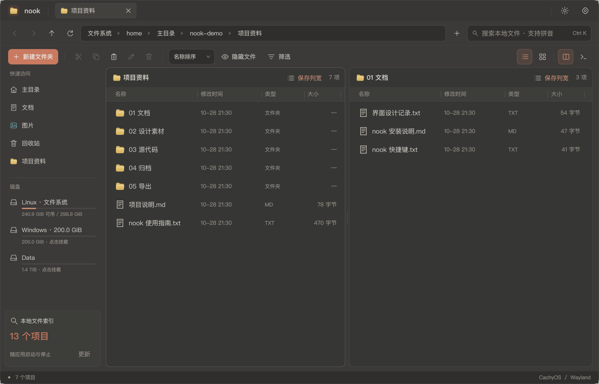
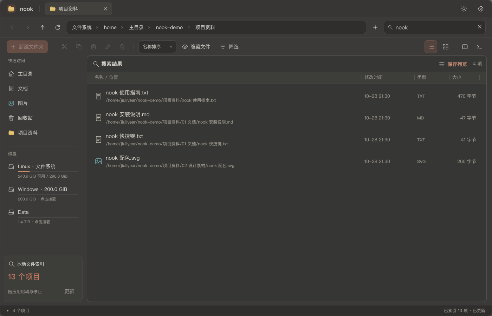
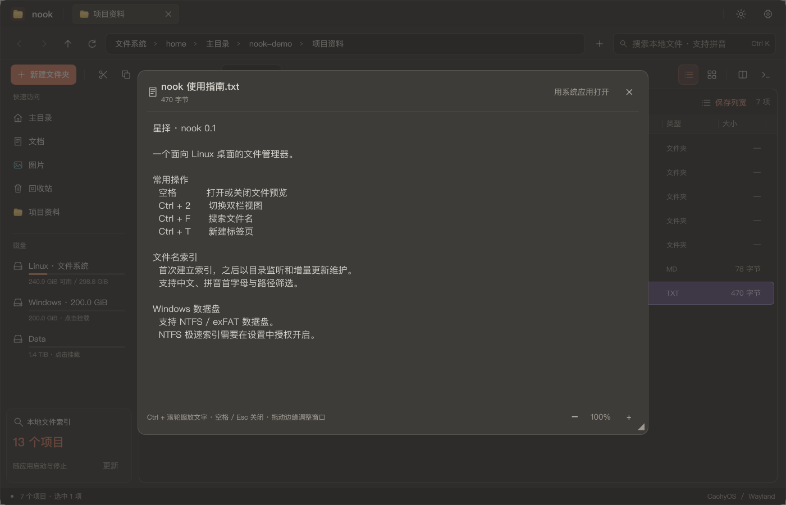

# nook · 星择

原生 Linux 文件管理器，面向 CachyOS / Arch Linux，使用 Qt Quick 和 C++20 开发。

## 功能

- **文件名索引搜索**：接近 Everything 的使用方式，支持中文、拼音首字母、路径和类型筛选。
- **减少重复扫描**：首次建立索引，之后用目录监听更新，配合低优先级补扫；NTFS 极速模式读取文件表与变更日志，不必每次遍历整个分区。
- **Windows 盘也能搜**：支持已挂载的 NTFS / exFAT 数据盘。NTFS 极速索引需在设置中授权开启，读取助手只读访问分区。
- **熟悉的文件管理布局**：侧栏、地址栏、标签页、列表和网格视图，Windows 用户也容易上手。
- **双栏操作**：同时打开两个目录，支持拖拽、复制和移动。
- **文件撤销**：空白处右键或 Ctrl+Z 撤销粘贴、移动、重命名、新建及移入回收站；侧栏保留本次运行最近 5 条记录，替代最近访问列表。遇到文件变化或原位置占用时停止，不覆盖现有文件；永久删除、覆盖替换、跨盘移动、非 UTF-8 文件名和远程操作不支持。详见[撤销说明](docs/UNDO.md)。
- **快速预览**：空格打开／关闭预览；可开启静态文件悬停预览，预览窗口支持调整大小。
- **简洁的右键菜单**：保留常用操作，支持新建文件、打开方式、快速访问、属性和权限设置。
- **按习惯调整**：深浅主题、界面缩放、列宽保存、快速访问排序，以及数据盘自动挂载设置。
- **nook解压缩**（开发中）：独立的压缩软件 `nook-archive`，与 nook 同一风格。浏览、解压、测试 ZIP、7z、RAR、tar 等压缩包，中文旧编码文件名自动识别；新建 ZIP、7z、tar.* 压缩包，支持 AES-256 加密、7z 分卷；任务排队、关窗后台继续、完成通知，密码可存入系统密钥环。nook 右键菜单可直接“压缩…”“压缩为 <名称>.zip”“解压到当前文件夹”“解压到…”。ZIP、7z、tar.* 压缩包里可以直接添加、删除、重命名，双击打开包内文件，保存后询问是否写回；可拖入拖出，可转换格式（旧编码 ZIP 转为 UTF-8 文件名）。空窗口和设置页可主动设为默认压缩软件（先确认与备份），也可恢复之前的默认；不会自动接管。阶段进度见[设计文档](docs/ARCHIVE-DESIGN.md)，自动对比与实机待验项见[验收清单](docs/ARCHIVE-ACCEPTANCE.md)。
- **替代系统文件管理器**：提供 `org.freedesktop.FileManager1`（其他应用的“在文件夹中显示”会打开 nook），并自带与 nook 同风格的“打开／保存”文件选择器（xdg-desktop-portal 后端）。

## 实机截图

以下为 CachyOS / niri / Wayland 下运行 nook 0.1 的实机截图，使用演示文件展示功能。







## 下载与安装

在 [Releases](https://github.com/Pasitearko/nook/releases/latest) 下载 `nook-0.1-1-x86_64.pkg.tar.zst`，然后运行：

```bash
sudo pacman -U ./nook-0.1-1-x86_64.pkg.tar.zst
nook
```

适用于 **x86_64 CachyOS / Arch Linux**，需系统提供 Qt 6.8 或更新版本。PDF 预览需 `poppler`，音视频预览需 `ffmpeg`：

```bash
sudo pacman -S --needed poppler ffmpeg
```

### 设为默认文件管理器与文件选择器（可选）

```bash
# 打开文件夹默认用 nook
xdg-mime default local.nook.desktop inode/directory
# 其他应用“在文件夹中显示”交给 nook（覆盖 Nautilus 等的同名服务）
mkdir -p ~/.local/share/dbus-1/services
printf '[D-BUS Service]\nName=org.freedesktop.FileManager1\nExec=/usr/bin/nook --service\n' > ~/.local/share/dbus-1/services/org.freedesktop.FileManager1.service
```

文件选择器：在 `~/.config/xdg-desktop-portal/niri-portals.conf`（或当前桌面对应的 `*-portals.conf`）的 `[preferred]` 中写入
`org.freedesktop.impl.portal.FileChooser=nook;gnome;gtk;`，然后 `systemctl --user restart xdg-desktop-portal`。
niri 下让选择器浮动打开的窗口规则见 `/usr/share/doc/nook/niri.example.kdl`。

卸载：`sudo pacman -R nook`。个人配置和索引会保留。

## 技术实现

| 部分 | 实现 |
| --- | --- |
| 界面 | Qt 6 Quick / QML，原生 Wayland，C++20 后端 |
| 文件操作 | GLib / GIO，接入系统默认应用和回收站 |
| 文件名索引 | SQLite / FTS5，后台任务、目录监听和增量更新 |
| 中文搜索 | ICU 规范化与拼音转换 |
| NTFS 极速索引 | 只读读取 `$MFT` 和 USN 日志，授权助手只传递只读分区描述符，解析在普通用户进程完成 |
| 预览与缩略图 | 独立受限工作进程；Qt 图片解码，可选 Poppler / FFmpeg |
| 系统挂载 | polkit 授权助手，备份并更新受管 fstab 条目 |
| 构建与测试 | CMake / Ninja、Qt Test、Python helper 测试 |

索引针对**文件名和路径**，不是文件内容全文搜索。目录监听受系统资源限制，NTFS 日志不可用时会回退扫描；Windows 休眠或快速启动可能影响分区挂载。详见[挂载说明](docs/AUTOMOUNT-DESIGN.md)。

## 从源码构建

```bash
sudo pacman -S --needed base-devel cmake ninja pkgconf qt6-base qt6-declarative qt6-shadertools qt6-svg qt6-imageformats glib2 sqlite icu polkit python libarchive 7zip libsecret
cmake -S . -B build -G Ninja -DCMAKE_BUILD_TYPE=Release
cmake --build build
ctest --test-dir build --output-on-failure
./build/nook
```

构建安装包：`bash tools/package.sh`，产物位于 `build/package/`。系统挂载与 NTFS 读取助手需要通过软件包安装。

开发验证可用 `./build/nook --profile-dir /tmp/nook-review --no-index`，只隔离 nook 数据，保留系统输入法和主题。输入法样式问题见[说明](docs/INPUT-METHOD.md)。

## 开源声明

nook 采用 [Apache-2.0](LICENSE) 协议。界面布局与交互借鉴 [Pulse](https://github.com/jimmgreen/pulse)，Linux 后端独立实现，不代表上游项目或获得其背书。依赖与来源见 [THIRD_PARTY.md](THIRD_PARTY.md)。
