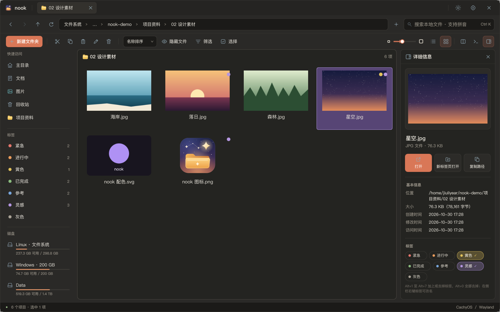
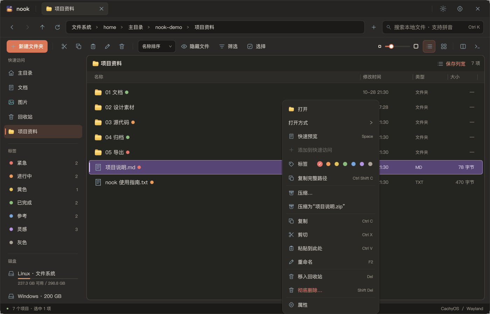
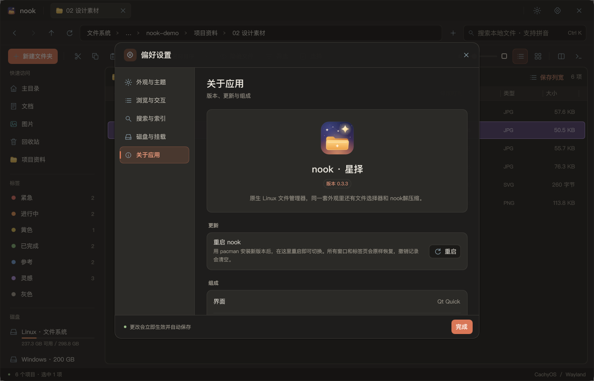

<p align="center">
  
</p>

<h1 align="center">nook · 星择</h1>

<p align="center">
  原生 Linux 文件管理器，面向 CachyOS / Arch Linux，使用 Qt Quick 和 C++20 开发。
</p>

<p align="center">
  <a href="https://github.com/Pasitearko/nook/releases/latest"></a>
  
  
  <a href="LICENSE"></a>
</p>

<p align="center">
  <a href="#下载与安装">下载与安装</a> ·
  <a href="#实机截图">实机截图</a> ·
  <a href="#nook-文件选择器">文件选择器</a> ·
  <a href="#nook解压缩">nook解压缩</a> ·
  <a href="#从源码构建">从源码构建</a>
</p>



一个安装包里有三样东西，外观一致：

| | |
| --- | --- |
| **nook** | 文件管理器：文件名索引搜索、颜色标签、双栏、预览、详细信息窗格和撤销 |
| **nook 文件选择器** | 其他应用“打开／保存文件”时弹出的窗口，替换系统自带的那个 |
| **nook解压缩** | 独立的压缩软件：浏览、解压、新建和修改压缩包，可设为默认压缩软件 |

## nook 文件管理器

### 浏览

- **熟悉的布局**：侧栏、地址栏、标签页、列表和网格视图，Windows 用户也容易上手。标签页可以左右拖动排序，新标签页从启动目录打开。
- **双栏操作**：同时打开两个目录（Ctrl+2），支持拖拽、复制和移动。
- **详细信息窗格**：窗口最大化（或在 niri 里占满整行）时，文件右侧显示所选项目的预览（图片、文本开头）、位置、大小、包含内容、创建／修改／访问时间和标签，并提供“打开”“新标签页打开”“复制路径”三个按钮。拖动左边缘可以调整宽度，工具栏按钮可以隐藏它。
- **快速预览**：空格打开／关闭预览，图片可缩放和拖动，文本可按住 Ctrl 滚动滚轮缩放文字；可开启静态文件悬停预览，预览窗口支持调整大小。
- **文件视图大小**：工具栏列表／网格按钮左侧有一条滑轨，拖动圆点即可放大或缩小文件的文字和图标，也可以在文件区域按住 Ctrl 滚动滚轮。列表（80%～160%）和网格（60%～200%）分别记住各自的大小，经过 100% 时圆点会稍作停留，双击滑轨恢复 100%。
- **可调的侧栏**：“快速访问”“标签”“磁盘”三组可以拖动标题调整顺序，侧栏右边缘可以拖动调整宽度；侧栏较窄时，磁盘只显示简短名称（Linux、Windows、Data），容量条也会相应缩短。
- **简洁的右键菜单**：保留常用操作，支持新建文件、打开方式、快速访问、颜色标签、属性和权限设置；空白处右键可刷新（F5）、撤销、新建、粘贴，或在此处打开 kitty。

### 颜色标签



- 红、橙、黄、绿、蓝、紫、灰七种颜色，每种颜色的名字都可以改（侧栏右键标签 →“重命名…”），比如把红色改成“紧急”。
- 加标签的方式：在右键菜单里点颜色圆点、在详细信息窗格里点标签、按 Alt+1～Alt+7，或把文件拖到侧栏的标签上；Alt+0 全部去掉。
- 文件名后显示标签圆点，点圆点只看当前文件夹里带这个标签的项目；点侧栏的标签，列出所有带这个标签的文件和文件夹。侧栏里的标签也可以上下拖动调整顺序。
- 在 nook 里重命名、移动或删除文件时，标签会跟着更新。

### 搜索

- **文件名索引搜索**：接近 Everything 的使用方式，支持中文、拼音首字母、路径和类型筛选。
- **减少重复扫描**：首次建立索引，之后用目录监听更新，配合低优先级补扫；NTFS 极速模式读取文件表与变更日志，不必每次遍历整个分区。
- **Windows 盘也能搜**：支持已挂载的 NTFS / exFAT 数据盘。NTFS 极速索引需在设置中授权开启，读取助手只读访问分区。

### 文件操作

- **文件撤销**：空白处右键或 Ctrl+Z 撤销粘贴、移动、重命名、新建及移入回收站；侧栏保留本次运行最近 5 条记录，可点击任意一条单独撤销。遇到文件变化或原位置被占用时停止，不覆盖现有文件；永久删除、覆盖替换、跨盘移动、非 UTF-8 文件名和远程操作不支持撤销。详见[撤销说明](docs/UNDO.md)。
- **右键压缩与解压**：选中文件可“压缩…”或一键“压缩为 <名称>.zip”；选中压缩包可“解压到当前文件夹”“解压到…”，交给 nook解压缩 在后台完成。
- **在此处打开 kitty**：从工具栏或空白处右键打开终端，工作目录就是当前文件夹。

### 外观与系统集成

- **流畅的动效**：选中框和悬停底板会弹性滑动，进出文件夹带方向滑入，切换列表／网格时文件图标平滑过渡，排序和筛选时条目移到新位置；预览从文件图标放大展开，右键菜单、下拉框和对话框弹出时有动画。可在设置里关闭“轻量动效”。
- **按习惯调整**：深浅主题、界面缩放（只调整文件视图以外的界面）、列宽保存、快速访问排序，以及数据盘自动挂载设置。
- **替代系统文件管理器**：提供 `org.freedesktop.FileManager1`，其他应用的“在文件夹中显示”会打开 nook。
- **无缝升级**：用 pacman 装好新包后，在设置 →“关于应用”里点“重启”，所有窗口和标签页会原样恢复。

## 实机截图

以下截图都在 CachyOS / niri / Wayland 下用演示文件实机截取。

<table>
  <tr>
    <td width="50%"></td>
    <td width="50%"></td>
  </tr>
  <tr>
    <td align="center">双栏与浅色主题</td>
    <td align="center">文件名索引搜索，结果带完整位置</td>
  </tr>
  <tr>
    <td width="50%"></td>
    <td width="50%"></td>
  </tr>
  <tr>
    <td align="center">空格快速预览</td>
    <td align="center">设置里的“关于应用”，升级后一键重启</td>
  </tr>
</table>

## nook 文件选择器

浏览器、聊天软件等应用通过 xdg-desktop-portal 请求“打开文件”“保存文件”“选择文件夹”时，弹出的是 nook 风格的选择器，而不是 GTK 或 KDE 的默认对话框。

- 与 nook 相同的侧栏、快速访问、地址栏和列表，支持搜索、多选、新建文件夹和文件类型筛选。
- 保存时可直接改文件名，重名会先提示。
- 作为 portal 后端运行（`org.freedesktop.impl.portal.desktop.nook`），需要在 portal 配置里指定，见下文“设为默认”。nook解压缩 选择文件和解压位置时也用它。

## nook解压缩

独立的压缩软件 `nook-archive`（启动器里叫“nook解压缩”），与 nook 同一风格，用来替代 File Roller 这类归档管理器。

- **打开与浏览**：ZIP、7z、RAR、tar 及 tar.gz/xz/zst/bz2/lz4/lzma/lz/Z，gz/xz/zst 等单文件压缩，以及 ISO、deb、rpm、cpio、cab、lha、jar/apk、wim 等格式。像文件夹一样浏览，可以全包搜索。旧编码（GBK、Big5、Shift_JIS 等）的中文文件名会自动识别，也可以手动切换编码。
- **解压与测试**：解压全部或选中的项目，可以选择是否新建文件夹，同名文件可以询问、替换、跳过或保留两者；也可以测试压缩包是否完整。会挡住路径穿越、越界链接和危险权限；解压先写入临时目录，失败或取消不会留下半个文件。
- **新建压缩包**：可选 ZIP、7z、tar.*，以及 gz/xz/zst/bz2 单文件压缩，压缩等级分六档。ZIP 默认 AES-256 加密，7z 可以连文件名一起加密，也支持 7z 分卷；压缩后可以校验，也可以把源文件移到回收站。
- **直接修改压缩包**：在 ZIP、7z、tar.* 里添加、删除、重命名，删除前会确认。双击打开包里的文件，保存后每次都会询问是否写回。可以把文件拖进拖出，也可以转换格式（旧编码 ZIP 可转为 UTF-8 文件名）。所有修改先在副本上完成，校验通过才替换原文件。
- **任务与密码**：任务排队执行，可以调整顺序；关闭窗口后在后台继续，完成后发通知。用过的密码在本次运行中记住，也可以命名后存入系统密钥环。
- **设为默认压缩软件**：只在你确认后才更改。改之前备份 `~/.config/mimeapps.list`，之后可在设置里恢复原来的默认程序；不会自动接管。
- 鼠标拖动可以框选，按住 Ctrl 加选，点空白处取消选择；压缩包信息可以选中复制。

自动测试和与 File Roller 的对比结果见[验收清单](docs/ARCHIVE-ACCEPTANCE.md)：内容一致性、安全样本、1 GiB 级大包的用时和内存都已测过。RAR 等格式的真实样本和真实桌面上的交互仍在逐项实测，所以还不能说已经完全替代 File Roller。设计与各阶段记录见[设计文档](docs/ARCHIVE-DESIGN.md)。

## 下载与安装

一条命令安装最新版（直接从 [Releases](https://github.com/Pasitearko/nook/releases/latest) 取最新的安装包，bash、zsh、fish 都能用）：

```bash
sudo pacman -U "$(curl -fsSL https://api.github.com/repos/Pasitearko/nook/releases/latest | grep -o 'https://[^"]*x86_64\.pkg\.tar\.zst')"
```

也可以在 [Releases](https://github.com/Pasitearko/nook/releases/latest) 页面手动下载 `nook-<版本>-x86_64.pkg.tar.zst`，在它所在的文件夹里运行（文件夹里只留一个 nook 安装包）：

```bash
sudo pacman -U ./nook-*-x86_64.pkg.tar.zst
```

装好后在启动器里打开，或在终端运行：

```bash
nook            # 文件管理器
nook-archive    # nook解压缩
```

适用于 **x86_64 CachyOS / Arch Linux**，需系统提供 Qt 6.8 或更新版本。PDF 预览需 `poppler`，音视频预览需 `ffmpeg`，“在此处打开”需 `kitty`：

```bash
sudo pacman -S --needed poppler ffmpeg kitty
```

**升级**：装好新包后，在正在使用的 nook 里打开 设置 →“关于应用”，点“重启”即可换成新版本，所有窗口和标签页会原样恢复（0.3.1 起提供；更早的版本需先 `pkill -x nook` 再重新打开）。后台常驻且没有窗口时，nook 会自行切换到新版本。

**卸载**：`sudo pacman -R nook`。个人配置、标签和索引会保留。

### 设为默认（可选）

nook解压缩：打开它，在空窗口顶部的提示或设置页里点“设为默认压缩软件…”。

文件管理器：

```bash
# 打开文件夹默认用 nook
xdg-mime default local.nook.desktop inode/directory
# 其他应用“在文件夹中显示”交给 nook（覆盖 Nautilus 等的同名服务）
mkdir -p ~/.local/share/dbus-1/services
printf '[D-BUS Service]\nName=org.freedesktop.FileManager1\nExec=/usr/bin/nook --service\n' > ~/.local/share/dbus-1/services/org.freedesktop.FileManager1.service
```

文件选择器：在 `~/.config/xdg-desktop-portal/niri-portals.conf`（或当前桌面对应的 `*-portals.conf`）的 `[preferred]` 中写入
`org.freedesktop.impl.portal.FileChooser=nook;gnome;gtk;`，然后 `systemctl --user restart xdg-desktop-portal`。
niri 下让选择器浮动打开的窗口规则见 `/usr/share/doc/nook/niri.example.kdl`。

## 技术实现

| 部分 | 实现 |
| --- | --- |
| 界面 | Qt 6 Quick / QML，原生 Wayland，C++20 后端 |
| 文件操作 | GLib / GIO，接入系统默认应用和回收站 |
| 文件名索引 | SQLite / FTS5，后台任务、目录监听和增量更新 |
| 颜色标签 | 按文件 URI 保存在 nook 的数据目录（`tags.json`），任何文件系统都能用，随 nook 的移动、重命名和删除更新 |
| 压缩与解压 | 独立的普通权限工作进程，Landlock 限制写入范围；libarchive 和 7-Zip 双后端；密码经 libsecret 存入密钥环 |
| 文件选择器 | xdg-desktop-portal FileChooser 后端，与 nook 共用界面组件 |
| 中文搜索 | ICU 规范化与拼音转换 |
| NTFS 极速索引 | 只读读取 `$MFT` 和 USN 日志，授权助手只传递只读分区描述符，解析在普通用户进程完成 |
| 预览与缩略图 | 独立受限工作进程；Qt 图片解码，可选 Poppler / FFmpeg |
| 系统挂载 | polkit 授权助手，备份并更新受管 fstab 条目 |
| 构建与测试 | CMake / Ninja、Qt Test、Python helper 测试 |

索引针对**文件名和路径**，不是文件内容全文搜索。目录监听受系统资源限制，NTFS 日志不可用时会回退扫描；Windows 休眠或快速启动可能影响分区挂载。详见[挂载说明](docs/AUTOMOUNT-DESIGN.md)。

## 从源码构建

```bash
sudo pacman -S --needed base-devel cmake ninja pkgconf qt6-base qt6-declarative qt6-shadertools qt6-svg qt6-imageformats glib2 sqlite icu polkit python libarchive 7zip libsecret
cmake -S . -B build -G Ninja -DCMAKE_BUILD_TYPE=Release
cmake --build build
ctest --test-dir build --output-on-failure
./build/nook
```

构建安装包：`bash tools/package.sh`，产物位于 `build/package/`。系统挂载与 NTFS 读取助手需要通过软件包安装。

开发验证可用 `./build/nook --profile-dir /tmp/nook-review --no-index`，只隔离 nook 数据，保留系统输入法和主题。输入法样式问题见[说明](docs/INPUT-METHOD.md)。

README 截图取自 `~/nook-demo` 演示文件夹（不在仓库里，需自备），在 Wayland 会话里重新截取：

```bash
NOOK_README_SHOTS=docs/screenshots QT_QPA_PLATFORM=wayland ./build/nook-followup-ui-tests readmeScreenshots
```

## 开源声明

nook 采用 [Apache-2.0](LICENSE) 协议。界面布局与交互借鉴 [Pulse](https://github.com/jimmgreen/pulse)，Linux 后端独立实现，不代表上游项目或获得其背书。依赖与来源见 [THIRD_PARTY.md](THIRD_PARTY.md)。
